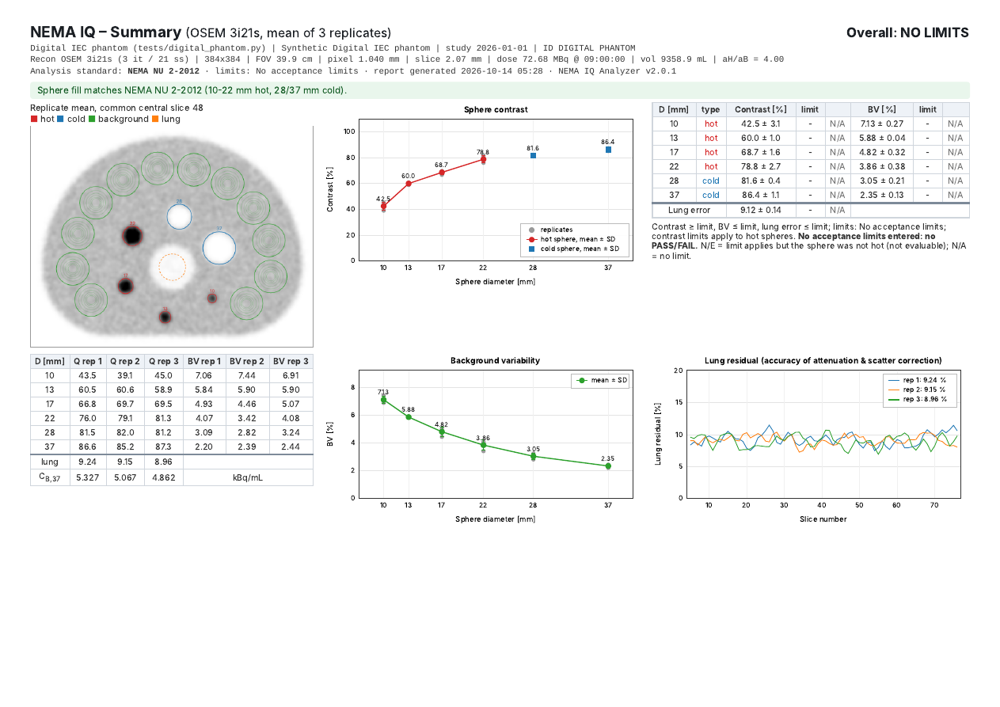

# NEMA IQ Analyzer

A single, self-contained HTML file (`NEMA_IQ_Analyzer.html`) for the analysis of the **NEMA NU 2 Image Quality test**
(IEC/NEMA body phantom: sphere contrast, background variability, lung residual) from PET DICOM images, according to
**NEMA NU 2-2012** or **NEMA NU 2-2018**.

- Runs locally in the browser (Chrome, Edge, Firefox). No installation, no internet connection, no external libraries.
- No data leave the computer: DICOM files are read and processed in the browser's memory.
- Produces a printable A4 report (PDF via the browser's print dialog) plus CSV/JSON/HTML exports.
- **Try it with one click:** [open the program with the demo dataset](https://yirmish.github.io/NEMA_IQ_Analyzer/NEMA_IQ_Analyzer.html?demo=1). A digital IEC phantom (no
  patient or site data) is downloaded and analysed, and the full report appears within seconds (see *Demo dataset*).

> **Not a medical device.** This software is provided for quality-assurance work by qualified medical physicists, without
> warranty of any kind. Verify the results, and follow the manufacturer's test procedure and acceptance criteria.

## Download

The program is the single file [`NEMA_IQ_Analyzer.html`](NEMA_IQ_Analyzer.html): download it (on GitHub: open the file,
then *Download raw file*, or take it from the *Releases* page) and open it in the browser. Nothing else is needed.
An example report is in [`docs/example_report.pdf`](docs/example_report.pdf). It was produced from a digital IEC body
phantom (no patient or site data) with `python docs/make_example.py`, which runs the program in a headless browser.
`SHA256SUMS.txt` lists the checksums of all files of the release.

## Demo dataset

[`demo/NEMA_IQ_demo_digital_phantom.zip`](demo/NEMA_IQ_demo_digital_phantom.zip) (4.4 MB) is a synthetic NEMA NU 2
image-quality study written by `tests/digital_phantom.py`: IEC body phantom with the NU 2-2012 fill (10–22 mm spheres
hot at 4:1, 28/37 mm cold), lung insert, three replicate acquisitions, 160 × 160 × 80 voxels of 2.5 mm, 6.5 mm
resolution and noise. It contains no patient, site or scanner data; `truth.json` in the ZIP gives the true geometry.

* **Online, one click:** <https://yirmish.github.io/NEMA_IQ_Analyzer/NEMA_IQ_Analyzer.html?demo=1> downloads the ZIP, selects NU 2-2012
  and runs the analysis. The button *Load demo dataset* in section 1 of the page does the same.
* **Offline:** download the ZIP, drag it onto the opened `NEMA_IQ_Analyzer.html` (or use *Select files…*), choose
  NU 2-2012 and click *Analyse*. The button cannot load the demo into a local copy: browsers do not let a `file://` page
  read other files.
* The demo button (or `?demo` in the address) is the only function that uses the network, and only to download this
  ZIP from the project website. Your own DICOM data are never sent anywhere.
* `python demo/make_demo.py` regenerates the ZIP byte for byte (fixed parameters, seed, UIDs and time stamps). The test
  suite analyses it (case `demo_dataset`).

## Quick start

1. Open `NEMA_IQ_Analyzer.html` (double-click).
2. **1 · DICOM data** — click *Select DICOM folder…* and choose the exported study folder, or drag the folder onto the page.
   A ZIP file of the export can be dragged onto the page or chosen with *Select files…* (standard ZIP, stored or
   deflated; not ZIP64 or encrypted).
   Browsers do not accept a typed path. Sub-folders are read. The series table lists every series. Attenuation-corrected
   PET series of one reconstruction are ticked as replicates. When a study contains several reconstructions of the same
   acquisitions, choose one in *Reconstruction*; run again with another choice for the next report.
3. **2 · Analysis settings**
   * *NEMA standard*: NU 2-2018 (all six spheres hot; lung slices within 30 mm of the insert ends excluded) or
     NU 2-2012 (10–22 mm hot, 28/37 mm cold; 10 mm exclusion). Choose the edition your acceptance protocol uses.
   * *Sphere : background ratio*: the true activity-concentration ratio of the fill (nominal 4.00).
   * *Sphere ROI slice*: one common slice through the sphere plane (default; as in the standard; matches the GE
     NEMA software) or the central slice of each sphere (for a tilted phantom).
   * *Lung-residual slices*: the exclusion (10 / 30 mm) is applied at the ends of the lung insert (default; matches the GE
     NEMA software). Where the insert continues beyond the axial FOV, slices up to the FOV edge are used; the second
     option excludes slices near the FOV edge as well (2.0.1 behaviour). An exclusion distance other than the standard's
     can be entered; the report then warns.
   * *Scanner profile* (optional): auto-detected from the DICOM header, or chosen from the list. A profile identifies the
     system and may provide **published reference values** that are shown for comparison. They are never used as limits.
   * *Acceptance limits*: none (results without PASS/FAIL), entered by hand, or loaded from a JSON file. Take the values
     from the manufacturer's documentation or your acceptance protocol. *Save these limits as JSON* stores them for re-use.
   * *Baseline* (optional): your own earlier result (e.g. the acceptance test), loaded from JSON. Create it with
     *Save as baseline (JSON)* after an analysis. A baseline is only used when its scanner model matches.
4. Click **Analyse**, then **Print / Save as PDF** (A4 landscape; enable "Background graphics").

## What the program does

* **Localisation (automatic):** phantom body, lung insert (axis and tilt) or, if the phantom has no lung insert, the sphere
  ring and body axis; sphere plane; the six spheres on the 57.2 mm ring, identified by size; hot/cold type of each sphere
  (checked against the selected edition). All sphere ROIs are placed on one common slice through the sphere plane
  (optionally each on its own central slice).
* **ROIs:** sphere ROIs with the sphere inner diameter; 12 background ROIs of each diameter on 5 slices (0, ±1, ±2 cm).
  The NEMA 15 mm wall/sphere margin is reduced in 0.5 mm steps when 12 non-overlapping 37 mm ROIs do not fit; the report
  says so. The wall is located with sub-pixel precision (50 % of the background in the smoothed image). Lung ROI 30 mm on
  every slice outside the exclusion zone at the insert ends. ROI means use fractional (sub-pixel) weights.
* **Formulas:** QH = (CH/CB − 1)/(aH/aB − 1) × 100;
  QC = (1 − CC/CB) × 100; BV = SD/CB × 100 over 60 ROIs (K − 1);
  lung error = Clung/CB,37 × 100, averaged over slices; results are the mean (± SD) over replicates.
* **Checks:** fill vs edition, protocol items (acquisition and reconstruction; expected values from the selected profile
  when published), corrections (attenuation, scatter), units, decay correction, measured vs expected background activity
  (from the injected activity and phantom volume in the DICOM header), replicate consistency, CT numbers (if the CT is in
  the folder).
* **Report:** summary; QA details; one page per replicate; appendix with ROI coordinates and lung residual per slice.

### Calculation conventions

* **Lung residual:** Clung,i (30 mm ROI on slice i) is divided by CB,37, the mean of all 60 background
  ROIs of 37 mm (12 ROIs × 5 slices), following the definition of CB in the standard. Because the formula is
  written with a slice index (CB,i), some implementations use a per-slice background instead; results from
  other software may therefore differ slightly. Compare like with like.
* **Lung-residual slices:** the exclusion zone (NU 2-2012: 10 mm, NU 2-2018: 30 mm) is measured from the ends of the lung
  insert. On systems whose axial FOV is shorter than the phantom (e.g. 15-20 cm), the insert usually continues beyond the
  first or last image slice; that end of the slice range is the FOV edge, not an insert end, and by default no slices are
  excluded there. The slices at the FOV edge have low sensitivity and add scan-to-scan variation; the *fov-edge* option
  excludes them (2.0.0/2.0.1 behaviour). With the whole insert inside the FOV both options give the same result.
* **Sphere ROI slice:** by default all sphere ROIs lie on the slice nearest the sphere plane (median of the six sphere
  centres). With a tilted phantom the sphere centres may round to different slices; the per-sphere option then places each
  ROI on its own central slice, which gives slightly higher contrast for the spheres that are off the common slice.
* **Replicates:** results are the mean (± SD) over the replicate acquisitions of the same reconstruction. Different
  reconstructions of the same acquisition are never averaged. With a single acquisition no SD is given.
* **Sphere type:** hot/cold is measured from the images. If the fill does not match the selected edition (e.g. 28/37 mm
  cold under NU 2-2018), the spheres are analysed with their measured type and limits for those spheres are reported as
  *not evaluable (N/E)*. A baseline comparison is made only for spheres of the same type.
* **Fill ratio:** contrast uses the ratio entered by the user (use the actual ratio of the preparation, not the nominal
  4.00). NU 2-2018 specifies 4:1 only; NU 2-2012 also allows 8:1.
* **Scan time:** NU 2-2012/2018 prescribe the time per bed position that a 100 cm whole-body scan would take in 30 min
  (T = 30 min × bed step / 100 cm). The QA page shows the bed step implied by the acquired time; the expected time for
  your system follows from its bed step (axial FOV minus overlap) in your clinical protocol.

## Vendor DICOM handling

| Item | Handling |
|---|---|
| Units | `BQML` used directly. Philips `CNTS` converted to Bq/mL with the *Activity Concentration Scale Factor* (7053,1009) of the "Philips PET Private Group" (value 0 or missing → not quantitative). Other units: contrast, BV and lung residual (ratios) are still valid; the measured-vs-expected activity check is skipped. |
| Rescale | Rescale Slope/Intercept applied slice by slice (Siemens and others use a different slope per slice). |
| Decay correction | `START` (to the acquisition start of each series) and `ADMIN` (to the injection time) are both handled in the activity and replicate-consistency checks. |
| Corrections | Series without attenuation correction (Corrected Image lacks `ATTN`) are not offered for analysis. |
| Reconstruction | Read from GE private tags where present; otherwise from Reconstruction Method (e.g. Siemens `PSF+TOF 2i21s`) and Convolution Kernel (e.g. `XYZ Gauss2.00`). |
| Transfer syntax | Uncompressed Explicit/Implicit VR Little Endian and Explicit VR Big Endian. Compressed (JPEG, JPEG-LS, JPEG 2000, RLE, Deflate) and the Philips private syntax are reported with a clear message; re-export uncompressed. |

## Scanner profiles

Profiles are optional. They identify a system from the DICOM header (Manufacturer, Manufacturer's Model Name and, for GE,
the axial FOV) and may contain a published acquisition/reconstruction protocol and published reference values. The
reference values are shown for comparison (purple markers and a Δ column) and are **never** used as PASS/FAIL limits,
except the Discovery IQ "prescribed limits" quoted by Jha et al. 2019 and the Omni Legend 32 cm specification quoted by
Smith et al. 2024, which can be selected explicitly as limits.

| Profile | Auto-detection | Published reference | Remarks |
|---|---|---|---|
| Siemens Biograph mCT (4 rings, TrueV) | `mCT` (not followed by `Flow`) | Karlberg 2016 (NU 2-2007, contrast only) | |
| Siemens Biograph mCT Flow | `mCT Flow` | Rausch 2015 (NU 2-2012) | |
| Siemens Biograph Horizon | `Horizon` | none found | identification only |
| Siemens Biograph Vision 450 | `Biograph…_Vision 3R` | Carlier 2020 | model string from Siemens DCS; 3R → 450 inferred |
| Siemens Biograph Vision 600 | `Biograph…_Vision 4R` | van Sluis 2019 (secondary transcription) | provisional |
| GE Discovery IQ (5 rings) | `Discovery IQ` | Jha 2019, Vallot 2020; Reynes-Llompart 2017 (secondary, provisional) | manufacturer protocol as published by Vallot 2020; optional published limits (Jha 2019) |
| GE Discovery MI, 3 rings | `Discovery MI` + axial FOV | Vandendriessche 2019 | protocol: Vandendriessche 2019 |
| GE Discovery MI, 4 rings | `Discovery MI` + axial FOV | Hsu 2017 (contrast only) | protocol: Chicheportiche 2020 |
| GE Discovery MI, 5 rings | `Discovery MI` + axial FOV | Pan 2019; Zeimpekis 2022 (Gen 2, NU 2-2018) | protocol: Zeimpekis 2022 |
| GE Discovery MI, 6 rings | `Discovery MI` + axial FOV | Zeimpekis 2022 (Gen 2, NU 2-2018) | protocol: Zeimpekis 2022 |
| GE Discovery MI DR | `Discovery MI DR` | none found | protocol: Chicheportiche 2020 |
| GE Omni Legend, 16 / 21 cm | `Omni Legend` + axial FOV | none found | identification only |
| GE Omni Legend, 32 cm | `Omni Legend` + axial FOV | Smith 2024 (NU 2-2018; VPHD, Q.Clear, Precision DL; preprint values, provisional) | protocol: Smith 2024; optional published limits (GE specification quoted by Smith 2024) |

For the Discovery MI and the Omni Legend the variant is chosen from the GE private axial-FOV tag; if that tag is absent
all variants are offered and the profile must be selected by hand.

Sources, details and the status of every value are listed in `SOURCES.md`. Additional profiles (other systems, your own
protocol) can be written with `templates/profile_template.json` and loaded with *Load profile JSON…*, or added to
`scanner_profiles.json` and built into the HTML (see *Building from source*).

## Files

| File | Purpose |
|---|---|
| `NEMA_IQ_Analyzer.html` | the program (everything inlined) |
| `index.html` | redirect of the project website to the program |
| `scanner_profiles.json` | built-in scanner profiles with sources (editable; rebuild to include changes) |
| `templates/limits_template.json` | acceptance-limit file format |
| `templates/baseline_template.json` | baseline file format (normally created by the program) |
| `templates/profile_template.json` | format for additional scanner profiles (load with *Load profile JSON…*) |
| `SOURCES.md` | the documents behind the analysis rules and the published sources of every profile value |
| `src/` | source code: `core.js` (DICOM reader and analysis), `report.js` (report), `ui.js` (interface), `template.html`, `profiles.js` (generated), `build.py`, `make_sources.py`, `test_core.js` |
| `demo/` | demo dataset (digital phantom, ZIP of PET DICOM) and `make_demo.py`, which regenerates it |
| `docs/` | example report (PDF) and page images of a digital phantom; `make_example.py` / `render_example.js` regenerate them; `social_preview.png` (repository card, `make_social_preview.py`) |
| `tests/` | verification on digital phantoms with known ground truth (see *Tests*) |
| `.github/workflows/` | `tests.yml`: rebuild and checksum check, digital-phantom tests; `release.yml`: tag and GitHub release |
| `CHANGELOG.md`, `LICENSE`, `CITATION.cff` | release notes, MIT licence, citation metadata |
| `SHA256SUMS.txt` | SHA-256 checksums of all files |

## Limitations

* Uncompressed DICOM only (see *Vendor DICOM handling*); compressed transfer syntaxes are reported but not decoded.
  Axial, non-oblique image series with uniform slice spacing; single-frame (classic) PET image objects.
* One bed position containing the phantom is expected; the phantom must be the IEC/NEMA body phantom with the standard
  sphere set (10–37 mm, 57.2 mm ring).
* Published reference values depend on acquisition, reconstruction and phantom preparation, and are no substitute for
  acceptance limits. Values marked *provisional* come from secondary sources or could not be checked against the final
publication.
* Validation so far: clinical phantom data from GE systems (Omni Legend 32 cm, NU 2-2012-type fill with lung insert,
  3 replicates; Discovery MI 4-ring, no lung insert, 2 reconstructions). The analysis agrees with an independent
  Python implementation (contrast within 0.01 percentage points), and with the manufacturer's IQ tool within −0.6 to
  +1.3 points when the manufacturer's slice and ROIs are used. Against results of the GE NEMA software for a Discovery MI
  (20 cm) and a Discovery MI DR (15 cm), NU 2-2012 fill, 3 scans each, with the default settings of 2.0.2: hot-sphere
  contrast within 3.7 points per scan (GE's own scan-to-scan SD 3.3) and 0.8 points for the 3-scan mean; cold-sphere
  contrast within 0.4 points; background variability bias +0.1 points (95 % limits −1.9 to +2.1; the background ROIs
  are placed independently of GE's); lung residual within 0.16 points. Hot-sphere contrast used the nominal 4.00 ratio. The Siemens and Philips DICOM conventions (units, scale
  factors, decay correction, model names) were implemented from the conformance statements and tested on modified
  copies of GE images only. The analysis is also verified on digital phantoms with known ground truth (see *Tests*),
  which test the software, not the behaviour of a real scanner. **Test the program on your own data before routine use.**

## Building from source

`python src/build.py` generates `src/profiles.js` from `scanner_profiles.json` and inlines all sources into
`NEMA_IQ_Analyzer.html`. `python src/make_sources.py` regenerates `SOURCES.md`.
`node src/test_core.js <DICOM folder> [2012|2018] [results.json] [series description]` runs the analysis without a
browser (Node.js; tested with version 26).

## Tests

`python tests/run_tests.py` (Python 3 with numpy and scipy: `pip install -r tests/requirements.txt`; Node.js) writes
digital IEC body phantoms as PET DICOM (`tests/digital_phantom.py`), analyses them with the analysis core
(`tests/analyse.js`) and checks the results in three ways:

* **Measurement:** an independent implementation of the ROI statistics, applied to the same images at the program's ROI
  positions, must give the same contrast, background variability and lung residual (to rounding).
* **Truth:** sphere identification, hot/cold type, sphere centres, phantom tilt, background concentration, decay
  correction, units and measured/expected activity against the known values; contrast against a sphere ROI centred on
  the true sphere centre.
* **Rules:** all sphere ROIs on the slice nearest the sphere plane (or, per-sphere option, each on the slice nearest its
  centre); 12 background ROIs at the required distance from wall, spheres and lung insert on the central slice and at
  ±10 and ±20 mm; lung-residual slices outside the exclusion zone of the selected edition at the insert ends, and up to
  the FOV edge where the insert continues beyond it (or excluded there with the *fov-edge* option).

The cases cover NU 2-2012 and 2018 fills, 4:1 and 8:1, with and without lung insert, tilt, offset and rotation, reversed
sphere order, both sphere-slice modes, 1.65-4 mm voxels, a 15.7 cm and a 22 cm axial FOV (lung insert leaving the FOV or
completely inside it, both lung-slice options), noise, replicates, decay correction START and ADMIN, Philips CNTS units,
Implicit VR files, a series without spheres (must be refused) and the demo dataset, read from its ZIP file. `--jobs 1` runs the cases one after the other without
worker processes. The digital phantom has no sphere walls and uses Gaussian noise
instead of reconstructed noise.

GitHub Actions (`.github/workflows/tests.yml`) runs these tests on every push and pull request, and checks that
`NEMA_IQ_Analyzer.html`, `src/profiles.js` and `SOURCES.md` are rebuilt identically from the sources and that
`SHA256SUMS.txt` matches all tracked files. After changing files, regenerate the checksums with
`git ls-files | grep -vx SHA256SUMS.txt | LC_ALL=C sort | xargs sha256sum > SHA256SUMS.txt`.

## Releasing

1. Set the version in `src/core.js` (`N.VERSION`) and `CITATION.cff`, date the section in `CHANGELOG.md`
   (`## x.y.z — YYYY-MM-DD`) and `date-released` in `CITATION.cff`, rebuild (`python src/build.py`) and regenerate
   `SHA256SUMS.txt`. Merge to `main`.
2. Run the *release* workflow (Actions → release → Run workflow on `main`, version `x.y.z`) or push the tag `vx.y.z`.
   It runs the tests, checks that version and date agree in all files, creates the tag and a GitHub release with the
   notes from `CHANGELOG.md` and `NEMA_IQ_Analyzer.html`, `SHA256SUMS.txt` and the demo ZIP attached. Run again for
   a version that is already released, it attaches the missing files from the tag (existing files are not replaced);
   releases are immutable once published (repository setting), so a missing file then needs a new version.

## Contributing

Reports of discrepancies, results on other systems (in particular Siemens, Philips, Canon and United Imaging), missing
or corrected published reference values, and new scanner profiles are welcome as GitHub issues or pull requests. Please
cite the table or page of every value you add. **Never attach DICOM files or reports that contain patient or site
identifiers**; describe the header fields instead (Manufacturer, Manufacturer's Model Name, Units, Decay Correction,
Transfer Syntax).

## Licence and disclaimer

Released under the [MIT License](LICENSE). The software is provided "as is", without warranty of any kind; it is not a
medical device and is not intended for diagnosis or treatment. NEMA NU 2 is a standard of the National Electrical
Manufacturers Association; this project is not affiliated with or endorsed by NEMA or by any scanner manufacturer.
Manufacturer and product names are trademarks of their respective owners.

## Citation

Citation metadata are in [`CITATION.cff`](CITATION.cff).
